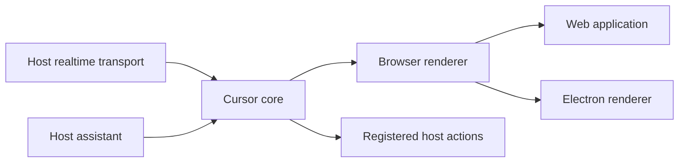

<p align="center">
  
</p>

# Cursor

**A TypeScript SDK for visible human and AI pointers in web and Electron applications.**

Show where another participant is pointing. Let an assistant guide someone to a control and invoke an action the application has registered.

[Why Cursor](#why-cursor-exists) · [Architecture](#architecture) · [Developer setup](#developer-setup) · [Agent documentation](#documentation-for-your-coding-agent) · [Documentation](.docs/README.md) · [Product icon](.github/assets/cursor-icon.png)

> **Status** · This private workspace contains the repository tooling, agent configuration and branding. The pointer runtime, framework adapters and reference application are planned in the [implementation plan](.docs/plan.md).

## Why Cursor exists

In a shared view, a visible pointer can show where another participant is looking or what an assistant is about to do. Pixel Brewery applications need the same interaction in a browser tab and an Electron window. A shared implementation gives those applications one way to position pointers and associate them with participants.

Each application supplies its own view identity, realtime connection and action handlers. A participant can indicate a settings control in a shared view. An assistant can point to the same control, then ask the application to open it through its registered action.

## Architecture

The planned TypeScript core owns pointer state and action requests. A browser library attaches that state to an application surface and draws the pointers. Electron uses the same library in its renderer. Angular, React, Vue and Svelte adapters connect the same controller to their component lifecycles.



| Application need                                    | Planned SDK boundary                                                           |
| --------------------------------------------------- | ------------------------------------------------------------------------------ |
| Show a participant’s pointer within the active view | Track current pointer state and render it within the registered surface        |
| Position a pointer across viewport sizes            | Resolve a shared surface position or a registered target in the receiving view |
| Guide a person to a control                         | Move the assistant pointer to a registered, visible target                     |
| Execute an allowed step                             | Invoke a registered handler through the host’s authorization decision          |
| Integrate with four UI frameworks                   | Mount and dispose the same browser controller through thin adapters            |

## Developer setup

Use Node.js 24.15 or later and the pinned Yarn 4.18.1. Supply `GITHUB_TOKEN` in the calling environment with read access to Pixel Brewery’s GitHub Packages registry for the Mosaik catalog dependency.

```sh
corepack enable
yarn install --immutable
yarn agents:sync
yarn agents:check
yarn agents:mcp-check
```

## Documentation for your coding agent

Start with [AGENTS.md](AGENTS.md). The project derives its architecture and design skills from pinned Pixel Brewery skills. Architecture applies to every repository task. UI decisions also use the project Designer and the local Mosaik catalog.

The workspace provides configuration for Codex, Claude Code, OpenCode, GitHub Copilot, Cursor IDE, Gemini CLI and VS Code. After editing the shared guidance, skills or MCP registry, regenerate the client files and run the drift check. [Agent configuration guide](.docs/README.md#agent-configuration)

## Documentation and verification

The [documentation index](.docs/README.md) links the repository setup, agent tooling and implementation plan. `yarn agents:check` checks reproducible agent configuration. `yarn agents:mcp-check` starts the pinned local Mosaik MCP and checks its tool inventory. The [runtime acceptance matrix](.docs/plan.md#acceptance) defines the evidence required when the runtime is implemented.
